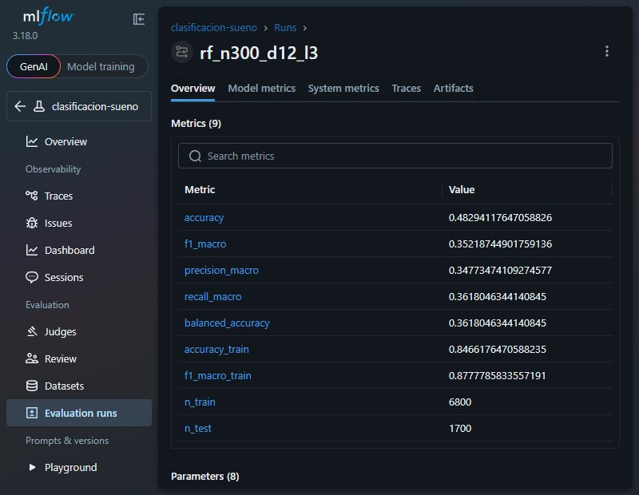
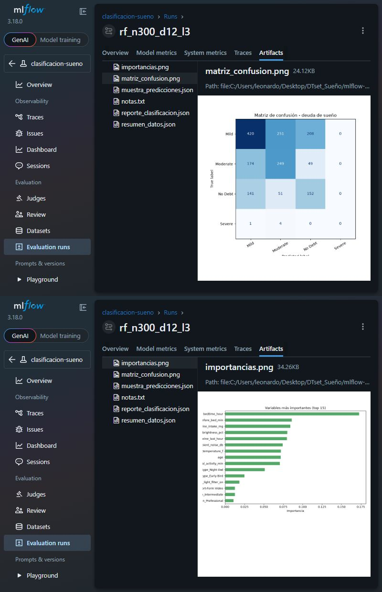
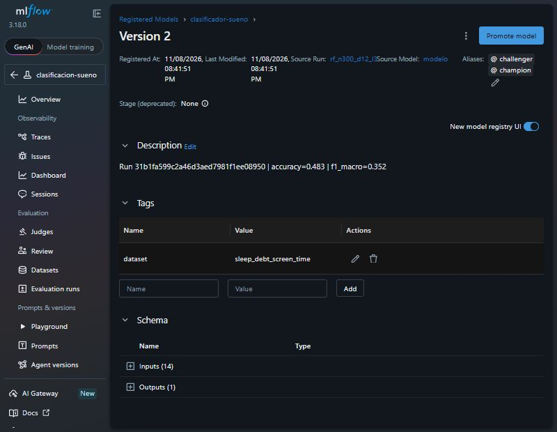
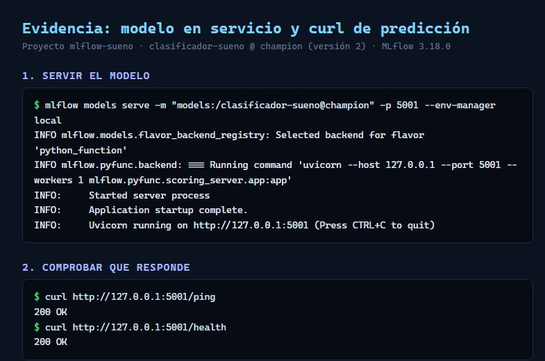
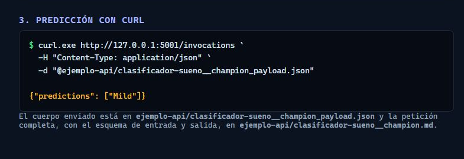

# Clasificación de deuda de sueño con MLflow

Adaptación del tutorial de referencia de MLflow al dataset
**`sleep_debt_screen_time.csv`** (8.500 noches, 23 columnas).

El tutorial original usa el dataset de vinos y un `RandomForestClassifier`.
Aquí se mantiene exactamente el mismo flujo de MLflow —tracking, parámetros,
métricas, artefactos, dataset, modelo, registro, alias, serving y administración
por terminal— pero el problema cambia a:

> Predecir la **categoría de deuda de sueño** (`sleep_debt_category`:
> `No Debt`, `Mild`, `Moderate`, `Severe`) usando solo hábitos de la noche
> anterior.

## Por qué clasificación y no regresión

El tutorial de referencia está construido alrededor de un clasificador:
`accuracy`, `f1_macro`, matriz de confusión y `RandomForestClassifier`. Para
seguirlo "tal cual", se usa la columna categórica del dataset:

| Target | Tipo | Uso |
|---|---|---|
| `sleep_debt_category` | 4 clases | **Este proyecto (clasificación)** |
| `next_day_fatigue_score` | continuo 1–10 | Proyecto de regresión aparte |

El proyecto de regresión que ya existe en la carpeta raíz sigue siendo válido;
este subproyecto es la versión MLflow del tutorial.

## Variables de entrada

Se usan **solo variables de comportamiento conocidas antes de dormir**:

```
age, gender, chronotype, occupation, bedtime_hour,
screen_time_before_bed_min, primary_app_category, screen_brightness_pct,
blue_light_filter_on, caffeine_intake_mg, caffeine_last_hour,
physical_activity_min, room_temperature_f, ambient_noise_db
```

No se usan `total_sleep_hours`, `sleep_efficiency_pct`, `rem_sleep_pct`,
`deep_sleep_pct`, `awakenings_count` ni `sleep_onset_latency_min`: son datos
fisiológicos que solo se conocen **después** de dormir. Usarlos sería **fuga de
información** (*data leakage*): el modelo parecería excelente, pero no serviría
para predecir antes de la noche.

## Estructura

```
mlflow-sueno/
├── README.md
├── requirements.txt
├── .env.example
├── .gitignore
├── MLproject
├── data/
│   ├── sleep_debt_screen_time.csv   # copia del dataset original
│   └── nuevas_noches.csv            # 5 filas de ejemplo para predecir
├── notebooks/
│   └── 01_exploracion.ipynb         # exploración y primer run
├── src/
│   ├── config.py                    # nombres, target, features, semilla
│   ├── data.py                      # carga y partición estratificada
│   ├── train.py                     # entrena y registra en MLflow
│   ├── register.py                  # registra el mejor run como 'challenger'
│   ├── promote.py                   # mueve el alias 'champion'
│   ├── predict.py                   # carga por alias y predice un CSV
│   ├── evaluate.py                  # evalúa un modelo registrado
│   ├── ejemplo_api.py               # genera la petición/respuesta de la API
│   └── save_local.py                # guarda el modelo en una carpeta propia
├── ejemplo-api/                     # documentos .md por modelo y alias
├── evidencia/                       # capturas PNG y PDF de evidencia
├── mlflow.db                        # (generado) metadatos
├── mlruns/                          # (generado) artefactos y modelos
├── modelo_local/                    # (generado) copia autocontenida del modelo
└── dockerfile_out/                  # (generado) Dockerfile y model_dir
```

## Instalación

```powershell
cd mlflow-sueno
python -m venv .venv
.\.venv\Scripts\Activate.ps1

pip install mlflow scikit-learn pandas matplotlib
pip freeze > requirements.txt
```

En Linux o macOS:

```bash
python3 -m venv .venv
source .venv/bin/activate
pip install -r requirements.txt
```

## Fijar el almacén de MLflow

**PowerShell:**

```powershell
$env:MLFLOW_TRACKING_URI = "sqlite:///mlflow.db"
python -c "import mlflow; print(mlflow.get_tracking_uri())"
```

**Linux o macOS:**

```bash
export MLFLOW_TRACKING_URI=sqlite:///mlflow.db
```

**cmd:**

```bat
set MLFLOW_TRACKING_URI=sqlite:///mlflow.db
```

Fija el tracking URI **antes** de ejecutar cualquier script o de abrir Jupyter.
Si no lo haces, MLflow crea otro `mlflow.db` en la carpeta desde la que ejecutas
y la interfaz aparece vacía.

## Ciclo completo

```powershell
# 1) Entrenar varios intentos
python src/train.py --n-estimators 300 --max-depth 12 --run-name rf_base
python src/train.py --n-estimators 500 --max-depth 20 --min-samples-leaf 1 --run-name rf_profundo

# También con MLproject
mlflow run . --env-manager local --experiment-name clasificacion-sueno `
  -P n_estimators=400 -P max_depth=16

# 2) Registrar el mejor run como 'challenger'
python src/register.py

# 3) Promoverlo a producción (mueve el alias champion)
python src/promote.py

# 4) Predecir con el modelo en producción
python src/predict.py data/nuevas_noches.csv --alias champion

# 5) Evaluar el modelo registrado con mlflow.models.evaluate
python src/evaluate.py --alias champion

# 6) Ver todo en la interfaz (otra terminal, mismo almacén)
mlflow ui --backend-store-uri sqlite:///mlflow.db --port 5000
```

Resultado esperado:

- un experimento `clasificacion-sueno` con varios runs;
- el modelo `clasificador-sueno` en la pestaña **Models**, con los alias
  `challenger` y `champion`;
- `predicciones.csv` con la columna `prediccion`;
- gráficos `matriz_confusion.png` e `importancias.png` dentro de cada run.

> **Windows:** `mlflow run . --env-manager local` ejecuta `python src/train.py`
> usando el `python` que esté en el `PATH`. Activa el entorno virtual antes
> (`.\.venv\Scripts\Activate.ps1`) o el subproceso usará el Python global y
> fallará con `ModuleNotFoundError`.

### Resultados del barrido de hiperparámetros

Se ejecutaron 10 runs adicionales para comparar configuraciones. La tabla está
ordenada por `f1_macro`, que es el criterio de selección:

| Run | Árboles | Profundidad | Hoja mín. | class_weight | accuracy | f1_macro |
|---|---:|---:|---:|---|---:|---:|
| `rf_n300_d12_l3` | 300 | 12 | 3 | balanced_subsample | 0.483 | **0.352** |
| `rf_n300_d16_l3` | 300 | 16 | 3 | balanced_subsample | 0.509 | 0.349 |
| `rf_n300_d14_l2` | 300 | 14 | 2 | balanced_subsample | 0.505 | 0.349 |
| `rf_n500_d12_l2` | 500 | 12 | 2 | balanced_subsample | 0.482 | 0.348 |
| `rf_n800_d16_l3` | 800 | 16 | 3 | balanced_subsample | 0.510 | 0.348 |
| `rf_n500_d16_l3` | 500 | 16 | 3 | balanced_subsample | 0.507 | 0.347 |
| `rf_base` | 300 | 12 | 2 | balanced_subsample | 0.478 | 0.344 |
| `rf_n300_d10_l1` | 300 | 10 | 1 | balanced_subsample | 0.452 | 0.337 |
| `rf_n300_d12_l2_balanced` | 300 | 12 | 2 | balanced | 0.432 | 0.325 |
| `rf_n200_d8_l2` | 200 | 8 | 2 | balanced_subsample | 0.405 | 0.306 |
| `rf_n300_d12_l2_sin_peso` | 300 | 12 | 2 | none | **0.532** | 0.272 |

Conclusiones del barrido:

- El mejor por `f1_macro` fue **`rf_n300_d12_l3`** (`accuracy=0.483`,
  `f1_macro=0.352`). Se registró como **versión 2** y se promovió a
  `champion`.
- Aumentar árboles o profundidad **no mejora de forma clara**: a partir de
  profundidad 12 los resultados se estancan alrededor de 0.35.
- `class_weight='none'` da la **accuracy más alta (0.532)**, pero el
  `f1_macro` cae a 0.272 y el `recall_macro` a 0.294: el modelo apuesta por
  `Mild` y detecta peor las clases minoritarias.
- `balanced_subsample` baja la accuracy a ~0.48, pero sube el `f1_macro` a
  0.35 y reparte mejor los aciertos entre clases.

Reporte por clase del mejor run:

| Clase | Precision | Recall | F1 | Filas de prueba |
|---|---:|---:|---:|---:|
| `Mild` | 0.571 | 0.478 | 0.520 | 879 |
| `Moderate` | 0.449 | 0.528 | 0.485 | 472 |
| `No Debt` | 0.372 | 0.442 | 0.404 | 344 |
| `Severe` | 0.000 | 0.000 | 0.000 | 5 |

La clase `Severe` tiene solo **5 filas en el conjunto de prueba** (25 en todo el
dataset). El modelo no acierta ninguna, y eso hunde el `f1_macro` aunque las
otras tres clases vayan razonablemente. No es un fallo de MLflow: es una
limitación de los datos y del desbalance.

`mlflow.models.evaluate` sobre el nuevo `champion` reporta:
`accuracy_score=0.483`, `f1_score=0.485` (weighted), `precision_score=0.495`,
`recall_score=0.483` y `roc_auc=0.623`.

### ¿Cuál es el objetivo de todo esto?

Hay dos objetivos que conviene separar:

1. **Objetivo del modelo:** estimar la categoría de deuda de sueño de una
   persona usando solo sus hábitos de la noche anterior (pantalla, cafeína,
   brillo, hora de acostarse, etc.). Es un problema de clasificación con cuatro
   clases y datos desbalanceados.
2. **Objetivo de MLflow:** demostrar el ciclo MLOps completo alrededor de ese
   modelo: fijar el tracking URI, registrar parámetros, métricas, artefactos,
   dataset y modelo; comparar runs; registrar versiones; mover alias
   `champion`/`challenger`; servir el modelo como API; y administrar
   experimentos desde la terminal.

Es decir, **MLflow no mejora la precisión del modelo**. Lo que hace es que el
experimento sea **reproducible, comparable, rastreable y desplegable**. El
barrido de 10 runs sirve para ver el ciclo: entrenar variantes, compararlas con
una métrica común, elegir la mejor y promoverla sin tocar el código de
producción.

Si el objetivo fuera solo predecir con la mayor precisión posible, el siguiente
paso no sería añadir más árboles, sino mejorar los datos: agrupar `Severe` con
`Moderate`, conseguir más casos graves, añadir variables (estrés, salud, turnos)
o cambiar a la regresión de `next_day_fatigue_score`, que ya está trabajada en
la carpeta raíz.

## Qué se registra en cada run

| Elemento | Dónde |
|---|---|
| Hiperparámetros | `n_estimators`, `max_depth`, `min_samples_leaf`, `class_weight`, `seed`, `target` |
| Métricas | `accuracy`, `f1_macro`, `precision_macro`, `recall_macro`, `balanced_accuracy`, `accuracy_train`, `f1_macro_train` |
| Artefactos | `matriz_confusion.png`, `importancias.png`, `reporte_clasificacion.json`, `resumen_datos.json`, `muestra_predicciones.json`, `notas.txt` |
| Dataset | huella y esquema de entrenamiento y prueba con `mlflow.log_input` |
| Modelo | pipeline completo (preprocesamiento + Random Forest) con firma y ejemplo de entrada |

### Sobre las métricas y el desbalance

La clase `Severe` es **menos del 1 %** del dataset. Por eso:

- `accuracy` sola puede ser engañosa (un modelo que siempre diga `Mild` ya
  acierta más de la mitad);
- se reporta `f1_macro`, que promedia las cuatro clases por igual;
- `register.py` ordena por `f1_macro`, no por `accuracy`;
- el clasificador usa `class_weight="balanced_subsample"` para no ignorar las
  clases minoritarias.

## Consultar runs desde Python

```python
import mlflow

runs = mlflow.search_runs(
    experiment_names=["clasificacion-sueno"],
    order_by=["metrics.f1_macro DESC"],
    max_results=10,
)
print(runs[["run_id", "tags.mlflow.runName", "metrics.accuracy", "metrics.f1_macro"]])
```

## Servir el modelo como API REST

```powershell
$env:MLFLOW_TRACKING_URI = "sqlite:///mlflow.db"
mlflow models serve -m "models:/clasificador-sueno@champion" -p 5001 --env-manager local
```

En otra terminal:

```powershell
curl http://localhost:5001/ping

curl -s -X POST http://localhost:5001/invocations `
  -H "Content-Type: application/json" `
  -d '{"dataframe_records":[{"age":32,"gender":"Female","chronotype":"Intermediate","occupation":"Student","bedtime_hour":23.94,"screen_time_before_bed_min":102,"primary_app_category":"Social Media","screen_brightness_pct":100,"blue_light_filter_on":false,"caffeine_intake_mg":264,"caffeine_last_hour":21.5,"physical_activity_min":73,"room_temperature_f":73.5,"ambient_noise_db":32.6}]}'
```

También se puede predecir por lotes sin levantar servidor:

```powershell
mlflow models predict -m "models:/clasificador-sueno@champion" `
  -i data/nuevas_noches.csv -t csv -o salida.json --env-manager local
```

## Guardar el modelo en una carpeta propia

```powershell
python src/save_local.py --alias champion
mlflow models serve -m ./modelo_local -p 5002 --env-manager local
```

La carpeta `modelo_local/` es autocontenida: incluye el pipeline, la firma, el
ejemplo de entrada y las dependencias. Se puede copiar a otra máquina y servir
sin depender de `mlflow.db`.

## Ejemplo de la API (`ejemplo-api/`)

El proyecto incluye el mismo extra que la carpeta `ejemplo-api/` del repo de
panadería: un documento por cada pareja modelo-alias con el esquema de entrada,
el esquema de salida, el `curl` listo para ejecutar, el cuerpo JSON y la
respuesta real.

```powershell
python src/ejemplo_api.py --alias champion --alias challenger
```

Genera:

```
ejemplo-api/
├── clasificador-sueno__champion.md
├── clasificador-sueno__champion_payload.json
├── clasificador-sueno__challenger.md
└── clasificador-sueno__challenger_payload.json
```

Para probar el `curl` con el servidor del paso anterior:

```powershell
curl.exe http://127.0.0.1:5001/invocations `
  -H "Content-Type: application/json" `
  -d "@ejemplo-api/clasificador-sueno__champion_payload.json"
```

Respuesta real:

```json
{"predictions": ["Mild"]}
```

## Evidencia

La carpeta `evidencia/` contiene las capturas para la entrega:

| Archivo | Qué muestra |
|---|---|
| `1-Pruebas_aprobadas.png` | Métricas del run `rf_n300_d12_l3` en la interfaz de MLflow |
| `2-graficas.png` | Matriz de confusión e importancia de variables |
| `3-Modelo_registrado.png` | `clasificador-sueno` versión 2 con alias `champion` y `challenger` |
| `4-Puerto_Modelo.png` | Servidor de MLflow activo y respuestas de `/ping` y `/health` |
| `5-prediccion.png` | `curl` de predicción con la respuesta `{"predictions": ["Mild"]}` |
| `evidencia.pdf` | Las cinco capturas juntas, listas para entregar |

### Capturas

#### 1. Métricas del run ganador



#### 2. Gráficas del modelo



#### 3. Modelo registrado



#### 4. Modelo en servicio



#### 5. Predicción con curl



[Descargar el PDF con toda la evidencia](evidencia/evidencia.pdf)

## Preparar la imagen Docker

```powershell
mlflow models generate-dockerfile -m "models:/clasificador-sueno@champion" `
  -d dockerfile_out --env-manager local
```

Genera `dockerfile_out/Dockerfile` y `dockerfile_out/model_dir/` con el modelo y
sus dependencias. Es la base para construir la imagen:

```powershell
mlflow models build-docker -m "models:/clasificador-sueno@champion" `
  -n sueno-api:prueba --env-manager local
docker run --rm -p 8080:8080 sueno-api:prueba
```

`generate-dockerfile` se ejecutó con éxito. `build-docker` y `docker run` no se
probaron en este equipo porque Docker no está instalado.

## Administración desde la terminal

```powershell
mlflow experiments search
mlflow experiments get -n clasificacion-sueno
mlflow runs list --experiment-id 1
mlflow runs describe --run-id <ID>
mlflow artifacts list --run-id <ID>
mlflow artifacts download --run-id <ID> --dst-path descargado
```

Borrar tiene dos niveles: `mlflow runs delete` manda a la papelera y
`mlflow gc` elimina definitivamente. Revisa la papelera antes de usar `gc`.

## Mantenimiento

```powershell
mlflow --version
mlflow doctor
python -c "import mlflow; print(mlflow.get_tracking_uri())"

# Al actualizar MLflow, actualiza el esquema de la base de datos
pip install -U mlflow
mlflow db upgrade sqlite:///mlflow.db

# Copia de seguridad: base de datos y carpeta de artefactos JUNTAS
Copy-Item mlflow.db mlflow.db.bak
Copy-Item -Recurse mlruns mlruns.bak
```

## Problemas frecuentes

| Síntoma | Causa probable | Solución |
|---|---|---|
| La interfaz aparece vacía | Distinto tracking URI o distinta carpeta | Imprime `mlflow.get_tracking_uri()` y abre la UI con ese mismo `--backend-store-uri` |
| `No such artifact` | Se movió o renombró la carpeta del proyecto | Devuelve la carpeta a su sitio o usa una carpeta de modelo con `save_model` |
| `references untrusted types` | `skops` exige declarar tipos del modelo | Mantén `skops_trusted_types=["sklearn.tree._tree.Tree", "numpy.dtype"]` |
| `active experiment ID does not match...` | `train.py` llama a `set_experiment` bajo `mlflow run` | Ya está resuelto: solo llama si no existe `MLFLOW_RUN_ID` |
| `Address already in use` | El puerto está ocupado | Usa `--port 5001` |
| `KeyError: 'metrics.f1_macro'` | Ningún run guardó esa métrica | Revisa el nombre exacto en la interfaz |
| Un filtro por parámetro no devuelve nada | Los parámetros se guardan como texto | Usa comillas: `params.max_depth = '12'` |

## Diferencias con el tutorial original

| Tutorial (vinos) | Esta adaptación (sueño) |
|---|---|
| `load_wine()` | `data/sleep_debt_screen_time.csv` |
| Target: 3 clases de vino | Target: 4 clases de deuda de sueño |
| `RandomForestClassifier` sobre 13 features numéricas | Pipeline con one-hot para variables categóricas + Random Forest |
| `accuracy` y `f1_macro` | Se añaden `precision_macro`, `recall_macro` y `balanced_accuracy` |
| `register.py` ordena por `accuracy` | Ordena por `f1_macro` por el desbalance de clases |
| Matriz de confusión de 3 clases | Matriz de confusión de 4 clases |
| — | `promote.py`, `evaluate.py` y `save_local.py` para completar el ciclo |

El resto del tutorial —`MLFLOW_TRACKING_URI`, `start_run`, `log_*`,
`log_input`, `log_model`, `register_model`, alias, `models serve`,
`models predict`, `mlflow gc`, `mlflow doctor`— se aplica sin cambios.
